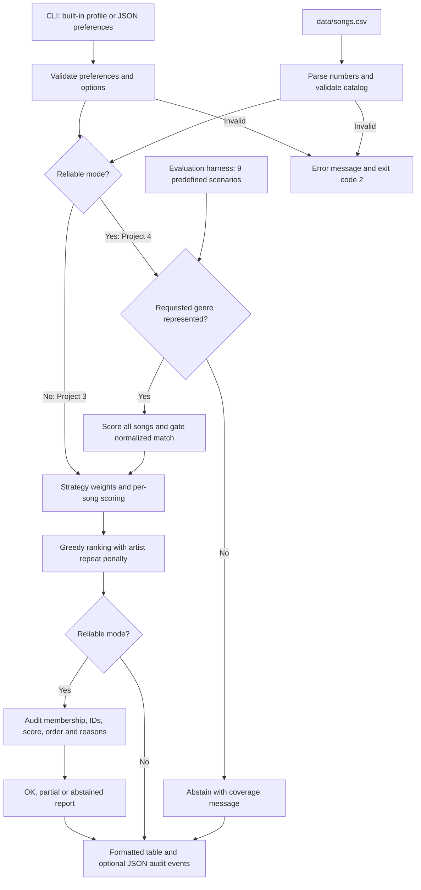

# Music Recommender Simulation — VibeFinder

This project turns a listener's preferences into ranked song suggestions and shows the math behind each result. Project 3 implements an explainable content-based recommender. Project 4 extends it with a reliability pipeline that validates data, checks catalog coverage, withholds weak matches, and audits the output.

Based on [CodePath's Music Recommender Simulation starter](https://github.com/codepath/ai110-module3show-musicrecommendersimulation-starter). The original starter supplied 10 songs, placeholder scoring/loading functions, a CLI, and two object-interface tests. This version preserves the original 10 rows and their existing values, adds 10 songs and five new attributes, and implements both starter interfaces.

## How The System Works

Real recommenders use interaction data such as listens, saves, skips, and watch history to estimate preferences. Spotify describes using both a person's listening habits and those of people with similar tastes ([Spotify Help](https://support.spotify.com/sc-en/article/find-playlists/)). YouTube lists watch history, likes, dislikes, and feedback among its recommendation signals ([YouTube Help](https://support.google.com/youtube/answer/16089387?hl=en)). Collaborative filtering finds patterns across users' behavior; content-based filtering compares the attributes of items with a user's preferences. Real services can combine multiple approaches. This project uses a hand-written content-based rule: it does not train a model, access a streaming account, or use other listeners' data.

There are three separate parts: **input data** describes songs, **user preferences** specify desired attributes, and **ranking/selection** scores candidates and chooses the best available matches. Genre and mood describe categories; energy, tempo, acousticness and the other numeric features describe a song's character. A taste profile supplies target values, so a low-energy listener is rewarded for closeness to low energy, rather than receiving the most energetic song every time.

### Data and preferences

`data/songs.csv` contains 20 illustrative tracks. These are classroom data, not measured Spotify audio features or verified commercial releases. The original columns are `id`, `title`, `artist`, `genre`, `mood`, `energy`, `tempo_bpm`, `valence`, `danceability`, and `acousticness`. Five added attributes are `instrumentalness`, `popularity`, `release_year`, `duration_seconds`, and `live_performance`. All five are used in scoring when a profile supplies them. Their values are synthetic.

Dictionary profiles require `genre`, `mood`, and `energy`; other feature targets are optional. Missing optional targets do not contribute points. `src/profiles.py` provides pop/happy, lofi/chill, and EDM/intense examples. The starter `UserProfile` object retains `favorite_genre`, `favorite_mood`, `target_energy`, and `likes_acoustic`; the object adapter maps these into the same dictionary scorer.

### Algorithm recipe

For each supplied numeric feature:

```text
similarity = 1 - abs(song_value - user_target) / (maximum - minimum)
contribution = feature_weight * similarity
base_score = sum(all contributions, including category matches)
selection_score = base_score - 0.6 * previously_selected_songs_by_same_artist
```

All numeric inputs must be finite and inside the documented range; similarity therefore stays between 0 and 1. Genre/mood matching is case-insensitive exact matching. It does not treat “indie pop” as identical to “pop.”

| Feature | Valid range | Genre-first weight | Mood-first weight | Energy-first weight |
| --- | --- | ---: | ---: | ---: |
| Genre match | Nonempty text | 2 | 1 | 1 |
| Mood match | Nonempty text | 1 | 2 | 1 |
| Energy | 0–1 | 1 | 1 | 2 |
| Tempo | 40–220 BPM | 0.5 | 0.5 | 0.5 |
| Valence, danceability, acousticness | 0–1 each | 0.25 each | 0.25 each | 0.25 each |
| Instrumentalness | 0–1 | 0.25 | 0.25 | 0.25 |
| Popularity | 0–100 | 0.25 | 0.25 | 0.25 |
| Release year | 1950–2030 | 0.25 | 0.25 | 0.25 |
| Duration | 60–600 seconds | 0.25 | 0.25 | 0.25 |
| Live performance | Song: 0 or 1; target: 0–1 | 0.25 | 0.25 | 0.25 |

The maximum base score for a complete profile is 6.5 in each mode. Popularity is a target similarity, not an automatic reward for fame. A low popularity target supports discovery of less-popular synthetic tracks.

`score_song()` returns a number and feature-level reasons. `recommend_songs()` ranks the whole list and returns `(song, selection_score, explanation)` tuples. With artist diversity enabled, it selects the best candidate, updates artist counts, and re-ranks the remaining candidates. Ties use ascending song ID. Scores are kept at full precision for ranking and rounded only for display. `sorted()` creates a new list, whereas `.sort()` modifies the list in place; the catalog is not reordered or mutated.

The Strategy pattern separates weight configurations from scoring. `RankingStrategy` objects in `STRATEGIES` share the same scoring procedure, making modes easy to compare without copying the algorithm. The CLI's default artist penalty is 0.6; the function's default is 0 for straightforward baseline use.

## Getting Started

Requires Python 3.10 or newer. The app and evaluation script use only the standard library; pytest is the only test dependency.

1. Clone your fork and enter it:

   ```bash
   git clone https://github.com/Somama12/ai110-module3show-musicrecommendersimulation-starter.git
   cd ai110-module3show-musicrecommendersimulation-starter
   ```

2. Create and activate an environment:

   ```bash
   python3 -m venv .venv
   source .venv/bin/activate
   # Windows: .venv\Scripts\activate
   ```

3. Install the test dependency and run the system:

   ```bash
   python -m pip install -r requirements.txt
   python -m src.main
   python -m src.main --profile lofi
   python -m src.main --profile edm --k 3
   python -m src.main --profile pop --mode mood-first
   python -m src.main --profile pop --mode energy-first
   python -m src.main --profile edm --artist-penalty 0
   ```

4. Run the automated checks:

   ```bash
   python -m pytest -q
   python -m src.evaluate
   ```

To use a custom profile, save a JSON object such as `{"genre":"pop","mood":"happy","energy":0.8}` and pass `--prefs path/to/profile.json`. `--prefs` overrides the named profile. Invalid inputs print an error and exit with status 2. Use `python -m src.main --help` to see all options.

## Sample Recommendation Output

These are captured outputs from the implemented CLI, including the actual score reasons. Each experiment requests five recommendations.

### POP profile

```bash
python -m src.main --profile pop
```

```text
Loaded songs: 20
Profile: pop | mode: genre-first
#   Song / Artist                                 Score  Reasons
-------------------------------------------------------------------------------------------------------------------
1   Golden Hour Ride / Daybreak Club              6.466  genre match (pop) (+2.000); mood match (happy) (+1.000);
                                                         energy 0.79 vs target 0.8 (+0.990); tempo_bpm 121 vs
                                                         target 120 (+0.497); valence 0.86 vs target 0.85 (+0.247);
                                                         danceability 0.81 vs target 0.8 (+0.247); acousticness
                                                         0.21 vs target 0.2 (+0.247); instrumentalness 0.04 vs
                                                         target 0.05 (+0.247); popularity 76 vs target 80 (+0.240);
                                                         release_year 2022 vs target 2022 (+0.250);
                                                         duration_seconds 208 vs target 210 (+0.249);
                                                         live_performance 0 vs target 0 (+0.250); artist repeat
                                                         penalty (-0.000); base 6.466

2   Sunrise City / Neon Echo                      6.459  genre match (pop) (+2.000); mood match (happy) (+1.000);
                                                         energy 0.82 vs target 0.8 (+0.980); tempo_bpm 118 vs
                                                         target 120 (+0.494); valence 0.84 vs target 0.85 (+0.247);
                                                         danceability 0.79 vs target 0.8 (+0.247); acousticness
                                                         0.18 vs target 0.2 (+0.245); instrumentalness 0.05 vs
                                                         target 0.05 (+0.250); popularity 82 vs target 80 (+0.245);
                                                         release_year 2022 vs target 2022 (+0.250);
                                                         duration_seconds 210 vs target 210 (+0.250);
                                                         live_performance 0 vs target 0 (+0.250); artist repeat
                                                         penalty (-0.000); base 6.459

3   Gym Hero / Max Pulse                          5.231  genre match (pop) (+2.000); mood mismatch (intense)
                                                         (+0.000); energy 0.93 vs target 0.8 (+0.870); tempo_bpm
                                                         132 vs target 120 (+0.467); valence 0.77 vs target 0.85
                                                         (+0.230); danceability 0.88 vs target 0.8 (+0.230);
                                                         acousticness 0.05 vs target 0.2 (+0.212); instrumentalness
                                                         0.02 vs target 0.05 (+0.242); popularity 85 vs target 80
                                                         (+0.237); release_year 2023 vs target 2022 (+0.247);
                                                         duration_seconds 200 vs target 210 (+0.245);
                                                         live_performance 0 vs target 0 (+0.250); artist repeat
                                                         penalty (-0.000); base 5.231

4   Rooftop Lights / Indigo Parade                4.328  genre mismatch (indie pop) (+0.000); mood match (happy)
                                                         (+1.000); energy 0.76 vs target 0.8 (+0.960); tempo_bpm
                                                         124 vs target 120 (+0.489); valence 0.81 vs target 0.85
                                                         (+0.240); danceability 0.82 vs target 0.8 (+0.245);
                                                         acousticness 0.35 vs target 0.2 (+0.213); instrumentalness
                                                         0.1 vs target 0.05 (+0.237); popularity 60 vs target 80
                                                         (+0.200); release_year 2021 vs target 2022 (+0.247);
                                                         duration_seconds 215 vs target 210 (+0.248);
                                                         live_performance 0 vs target 0 (+0.250); artist repeat
                                                         penalty (-0.000); base 4.328

5   City Notebook / Verse Atlas                   3.183  genre mismatch (hip-hop) (+0.000); mood mismatch (focused)
                                                         (+0.000); energy 0.7 vs target 0.8 (+0.900); tempo_bpm 94
                                                         vs target 120 (+0.428); valence 0.55 vs target 0.85
                                                         (+0.175); danceability 0.85 vs target 0.8 (+0.238);
                                                         acousticness 0.2 vs target 0.2 (+0.250); instrumentalness
                                                         0.02 vs target 0.05 (+0.242); popularity 61 vs target 80
                                                         (+0.203); release_year 2022 vs target 2022 (+0.250);
                                                         duration_seconds 205 vs target 210 (+0.248);
                                                         live_performance 0 vs target 0 (+0.250); artist repeat
                                                         penalty (-0.000); base 3.183
```

### LOFI profile

```bash
python -m src.main --profile lofi
```

```text
Loaded songs: 20
Profile: lofi | mode: genre-first
#   Song / Artist                                 Score  Reasons
-------------------------------------------------------------------------------------------------------------------
1   Paper Moon Loop / Quiet Current               6.466  genre match (lofi) (+2.000); mood match (chill) (+1.000);
                                                         energy 0.36 vs target 0.35 (+0.990); tempo_bpm 74 vs
                                                         target 75 (+0.497); valence 0.54 vs target 0.55 (+0.247);
                                                         danceability 0.51 vs target 0.5 (+0.247); acousticness
                                                         0.84 vs target 0.85 (+0.247); instrumentalness 0.93 vs
                                                         target 0.9 (+0.242); popularity 28 vs target 30 (+0.245);
                                                         release_year 2020 vs target 2020 (+0.250);
                                                         duration_seconds 182 vs target 180 (+0.249);
                                                         live_performance 0 vs target 0 (+0.250); artist repeat
                                                         penalty (-0.000); base 6.466

2   Library Rain / Paper Lanterns                 6.412  genre match (lofi) (+2.000); mood match (chill) (+1.000);
                                                         energy 0.35 vs target 0.35 (+1.000); tempo_bpm 72 vs
                                                         target 75 (+0.492); valence 0.6 vs target 0.55 (+0.238);
                                                         danceability 0.58 vs target 0.5 (+0.230); acousticness
                                                         0.86 vs target 0.85 (+0.247); instrumentalness 0.98 vs
                                                         target 0.9 (+0.230); popularity 24 vs target 30 (+0.235);
                                                         release_year 2021 vs target 2020 (+0.247);
                                                         duration_seconds 195 vs target 180 (+0.243);
                                                         live_performance 0 vs target 0 (+0.250); artist repeat
                                                         penalty (-0.000); base 6.412

3   Midnight Coding / LoRoom                      6.337  genre match (lofi) (+2.000); mood match (chill) (+1.000);
                                                         energy 0.42 vs target 0.35 (+0.930); tempo_bpm 78 vs
                                                         target 75 (+0.492); valence 0.56 vs target 0.55 (+0.247);
                                                         danceability 0.62 vs target 0.5 (+0.220); acousticness
                                                         0.71 vs target 0.85 (+0.215); instrumentalness 0.95 vs
                                                         target 0.9 (+0.238); popularity 32 vs target 30 (+0.245);
                                                         release_year 2020 vs target 2020 (+0.250);
                                                         duration_seconds 180 vs target 180 (+0.250);
                                                         live_performance 0 vs target 0 (+0.250); artist repeat
                                                         penalty (-0.000); base 6.337

4   Focus Flow / LoRoom                           4.758  genre match (lofi) (+2.000); mood mismatch (focused)
                                                         (+0.000); energy 0.4 vs target 0.35 (+0.950); tempo_bpm 80
                                                         vs target 75 (+0.486); valence 0.59 vs target 0.55
                                                         (+0.240); danceability 0.6 vs target 0.5 (+0.225);
                                                         acousticness 0.78 vs target 0.85 (+0.233);
                                                         instrumentalness 0.96 vs target 0.9 (+0.235); popularity
                                                         30 vs target 30 (+0.250); release_year 2022 vs target 2020
                                                         (+0.244); duration_seconds 170 vs target 180 (+0.245);
                                                         live_performance 0 vs target 0 (+0.250); artist repeat
                                                         penalty (-0.600); base 5.358

5   Sunday Strings / Cedar Lane                   4.290  genre mismatch (acoustic) (+0.000); mood match (chill)
                                                         (+1.000); energy 0.3 vs target 0.35 (+0.950); tempo_bpm 74
                                                         vs target 75 (+0.497); valence 0.58 vs target 0.55
                                                         (+0.243); danceability 0.4 vs target 0.5 (+0.225);
                                                         acousticness 0.98 vs target 0.85 (+0.217);
                                                         instrumentalness 0.6 vs target 0.9 (+0.175); popularity 25
                                                         vs target 30 (+0.237); release_year 2020 vs target 2020
                                                         (+0.250); duration_seconds 190 vs target 180 (+0.245);
                                                         live_performance 0 vs target 0 (+0.250); artist repeat
                                                         penalty (-0.000); base 4.290
```

### EDM profile

```bash
python -m src.main --profile edm
```

```text
Loaded songs: 20
Profile: edm | mode: genre-first
#   Song / Artist                                 Score  Reasons
-------------------------------------------------------------------------------------------------------------------
1   Electric Horizon / Pulse Arcade               6.470  genre match (edm) (+2.000); mood match (intense) (+1.000);
                                                         energy 0.96 vs target 0.95 (+0.990); tempo_bpm 145 vs
                                                         target 145 (+0.500); valence 0.65 vs target 0.65 (+0.250);
                                                         danceability 0.96 vs target 0.95 (+0.247); acousticness
                                                         0.03 vs target 0.05 (+0.245); instrumentalness 0.72 vs
                                                         target 0.7 (+0.245); popularity 68 vs target 65 (+0.242);
                                                         release_year 2023 vs target 2023 (+0.250);
                                                         duration_seconds 240 vs target 240 (+0.250);
                                                         live_performance 1 vs target 1 (+0.250); artist repeat
                                                         penalty (-0.000); base 6.470

2   Bassline Orbit / Signal Bloom                 6.138  genre match (edm) (+2.000); mood match (intense) (+1.000);
                                                         energy 0.92 vs target 0.95 (+0.970); tempo_bpm 150 vs
                                                         target 145 (+0.486); valence 0.62 vs target 0.65 (+0.242);
                                                         danceability 0.91 vs target 0.95 (+0.240); acousticness
                                                         0.06 vs target 0.05 (+0.247); instrumentalness 0.8 vs
                                                         target 0.7 (+0.225); popularity 58 vs target 65 (+0.232);
                                                         release_year 2024 vs target 2023 (+0.247);
                                                         duration_seconds 235 vs target 240 (+0.248);
                                                         live_performance 0 vs target 1 (+0.000); artist repeat
                                                         penalty (-0.000); base 6.138

3   Festival Afterglow / Pulse Arcade             5.842  genre match (edm) (+2.000); mood match (intense) (+1.000);
                                                         energy 0.93 vs target 0.95 (+0.980); tempo_bpm 142 vs
                                                         target 145 (+0.492); valence 0.68 vs target 0.65 (+0.242);
                                                         danceability 0.94 vs target 0.95 (+0.247); acousticness
                                                         0.04 vs target 0.05 (+0.247); instrumentalness 0.75 vs
                                                         target 0.7 (+0.237); popularity 66 vs target 65 (+0.247);
                                                         release_year 2023 vs target 2023 (+0.250);
                                                         duration_seconds 245 vs target 240 (+0.248);
                                                         live_performance 1 vs target 1 (+0.250); artist repeat
                                                         penalty (-0.600); base 6.442

4   Storm Runner / Voltline                       4.120  genre mismatch (rock) (+0.000); mood match (intense)
                                                         (+1.000); energy 0.91 vs target 0.95 (+0.960); tempo_bpm
                                                         152 vs target 145 (+0.481); valence 0.48 vs target 0.65
                                                         (+0.207); danceability 0.66 vs target 0.95 (+0.178);
                                                         acousticness 0.1 vs target 0.05 (+0.237); instrumentalness
                                                         0.08 vs target 0.7 (+0.095); popularity 72 vs target 65
                                                         (+0.232); release_year 2018 vs target 2023 (+0.234);
                                                         duration_seconds 230 vs target 240 (+0.245);
                                                         live_performance 1 vs target 1 (+0.250); artist repeat
                                                         penalty (-0.000); base 4.120

5   Gym Hero / Max Pulse                          3.908  genre mismatch (pop) (+0.000); mood match (intense)
                                                         (+1.000); energy 0.93 vs target 0.95 (+0.980); tempo_bpm
                                                         132 vs target 145 (+0.464); valence 0.77 vs target 0.65
                                                         (+0.220); danceability 0.88 vs target 0.95 (+0.233);
                                                         acousticness 0.05 vs target 0.05 (+0.250);
                                                         instrumentalness 0.02 vs target 0.7 (+0.080); popularity
                                                         85 vs target 65 (+0.200); release_year 2023 vs target 2023
                                                         (+0.250); duration_seconds 200 vs target 240 (+0.231);
                                                         live_performance 0 vs target 1 (+0.000); artist repeat
                                                         penalty (-0.000); base 3.908
```

## Experiments You Tried

All comparisons use the same catalog and a 0.6 artist penalty unless stated otherwise.

| Experiment | Before | After | Interpretation |
| --- | --- | --- | --- |
| Pop: genre-first → mood-first | Gym Hero is third (5.231) | Rooftop Lights is third (5.328) | The happy mood becomes more important than exact pop membership. |
| Pop: halve genre weight and double energy weight | Gym Hero is third (5.231) | Rooftop Lights is third (5.288) | Energy 0.76 is closer to the target 0.8 than 0.93. This is the `energy-first` mode. |
| EDM: artist penalty 0 → 0.6 | Electric Horizon, Festival Afterglow | Electric Horizon, Bassline Orbit | Top-two artist count rises from one to two. Festival Afterglow moves third and loses 0.6 points. |

The modes change an explicit design tradeoff; a changed list alone does not prove greater accuracy. The evaluation checks expected behavior, not real listener satisfaction.

## Project 4: Applied AI System Extension

The base is the Project 3 weighted recommender above. The substantial extension is an integrated **reliability mechanism**, one of the Project 4 feature options. It is a deterministic pipeline around a simulated AI recommender, not an LLM, RAG system, fine-tune, or autonomous runtime agent.

With `--reliable`, the system validates the request and catalog, checks whether the requested genre exists, removes songs whose normalized base score is below `--min-match` (default 0.70), ranks eligible songs with the artist penalty, and audits membership, duplicate IDs, scores, order, and explanations. It returns `ok`, `partial`, or `abstained`. It never pads the list with weak songs merely to reach k. An optional JSON trace records factual processing events, counts, selected IDs and scores.

The match fraction is `base_score / maximum_score_for_supplied_features`. It is a heuristic, **not a calibrated probability or confidence estimate**. The gate is applied before diversity; the displayed selection score can be lower after an artist penalty. The coverage check requires the requested genre to exist somewhere in the catalog, but eligible recommendations can include other genres.

The exact implementation diagram is in [architecture.mmd](architecture.mmd):



### Three end-to-end examples

These invoke the reliability pipeline and write audit logs. The full baseline outputs above make the profiles easy to compare; the reliable examples below request three results.

```bash
python -m src.main --profile pop --reliable --k 3 --trace examples/pop_trace.json
```

```text
Loaded songs: 20
Profile: pop | mode: genre-first
Status: ok | 3 of 3 requested songs meet match >= 0.70.
#   Song / Artist                                 Score  Reasons
-------------------------------------------------------------------------------------------------------------------
1   Golden Hour Ride / Daybreak Club              6.466  genre match (pop) (+2.000); mood match (happy) (+1.000);
                                                         energy 0.79 vs target 0.8 (+0.990); tempo_bpm 121 vs
                                                         target 120 (+0.497); valence 0.86 vs target 0.85 (+0.247);
                                                         danceability 0.81 vs target 0.8 (+0.247); acousticness
                                                         0.21 vs target 0.2 (+0.247); instrumentalness 0.04 vs
                                                         target 0.05 (+0.247); popularity 76 vs target 80 (+0.240);
                                                         release_year 2022 vs target 2022 (+0.250);
                                                         duration_seconds 208 vs target 210 (+0.249);
                                                         live_performance 0 vs target 0 (+0.250); artist repeat
                                                         penalty (-0.000); base 6.466

2   Sunrise City / Neon Echo                      6.459  genre match (pop) (+2.000); mood match (happy) (+1.000);
                                                         energy 0.82 vs target 0.8 (+0.980); tempo_bpm 118 vs
                                                         target 120 (+0.494); valence 0.84 vs target 0.85 (+0.247);
                                                         danceability 0.79 vs target 0.8 (+0.247); acousticness
                                                         0.18 vs target 0.2 (+0.245); instrumentalness 0.05 vs
                                                         target 0.05 (+0.250); popularity 82 vs target 80 (+0.245);
                                                         release_year 2022 vs target 2022 (+0.250);
                                                         duration_seconds 210 vs target 210 (+0.250);
                                                         live_performance 0 vs target 0 (+0.250); artist repeat
                                                         penalty (-0.000); base 6.459

3   Gym Hero / Max Pulse                          5.231  genre match (pop) (+2.000); mood mismatch (intense)
                                                         (+0.000); energy 0.93 vs target 0.8 (+0.870); tempo_bpm
                                                         132 vs target 120 (+0.467); valence 0.77 vs target 0.85
                                                         (+0.230); danceability 0.88 vs target 0.8 (+0.230);
                                                         acousticness 0.05 vs target 0.2 (+0.212); instrumentalness
                                                         0.02 vs target 0.05 (+0.242); popularity 85 vs target 80
                                                         (+0.237); release_year 2023 vs target 2022 (+0.247);
                                                         duration_seconds 200 vs target 210 (+0.245);
                                                         live_performance 0 vs target 0 (+0.250); artist repeat
                                                         penalty (-0.000); base 5.231
```

```bash
python -m src.main --profile lofi --reliable --k 3 --trace examples/lofi_trace.json
```

```text
Loaded songs: 20
Profile: lofi | mode: genre-first
Status: ok | 3 of 3 requested songs meet match >= 0.70.
#   Song / Artist                                 Score  Reasons
-------------------------------------------------------------------------------------------------------------------
1   Paper Moon Loop / Quiet Current               6.466  genre match (lofi) (+2.000); mood match (chill) (+1.000);
                                                         energy 0.36 vs target 0.35 (+0.990); tempo_bpm 74 vs
                                                         target 75 (+0.497); valence 0.54 vs target 0.55 (+0.247);
                                                         danceability 0.51 vs target 0.5 (+0.247); acousticness
                                                         0.84 vs target 0.85 (+0.247); instrumentalness 0.93 vs
                                                         target 0.9 (+0.242); popularity 28 vs target 30 (+0.245);
                                                         release_year 2020 vs target 2020 (+0.250);
                                                         duration_seconds 182 vs target 180 (+0.249);
                                                         live_performance 0 vs target 0 (+0.250); artist repeat
                                                         penalty (-0.000); base 6.466

2   Library Rain / Paper Lanterns                 6.412  genre match (lofi) (+2.000); mood match (chill) (+1.000);
                                                         energy 0.35 vs target 0.35 (+1.000); tempo_bpm 72 vs
                                                         target 75 (+0.492); valence 0.6 vs target 0.55 (+0.238);
                                                         danceability 0.58 vs target 0.5 (+0.230); acousticness
                                                         0.86 vs target 0.85 (+0.247); instrumentalness 0.98 vs
                                                         target 0.9 (+0.230); popularity 24 vs target 30 (+0.235);
                                                         release_year 2021 vs target 2020 (+0.247);
                                                         duration_seconds 195 vs target 180 (+0.243);
                                                         live_performance 0 vs target 0 (+0.250); artist repeat
                                                         penalty (-0.000); base 6.412

3   Midnight Coding / LoRoom                      6.337  genre match (lofi) (+2.000); mood match (chill) (+1.000);
                                                         energy 0.42 vs target 0.35 (+0.930); tempo_bpm 78 vs
                                                         target 75 (+0.492); valence 0.56 vs target 0.55 (+0.247);
                                                         danceability 0.62 vs target 0.5 (+0.220); acousticness
                                                         0.71 vs target 0.85 (+0.215); instrumentalness 0.95 vs
                                                         target 0.9 (+0.238); popularity 32 vs target 30 (+0.245);
                                                         release_year 2020 vs target 2020 (+0.250);
                                                         duration_seconds 180 vs target 180 (+0.250);
                                                         live_performance 0 vs target 0 (+0.250); artist repeat
                                                         penalty (-0.000); base 6.337
```

```bash
python -m src.main --profile edm --reliable --k 3 --trace examples/edm_trace.json
```

```text
Loaded songs: 20
Profile: edm | mode: genre-first
Status: ok | 3 of 3 requested songs meet match >= 0.70.
#   Song / Artist                                 Score  Reasons
-------------------------------------------------------------------------------------------------------------------
1   Electric Horizon / Pulse Arcade               6.470  genre match (edm) (+2.000); mood match (intense) (+1.000);
                                                         energy 0.96 vs target 0.95 (+0.990); tempo_bpm 145 vs
                                                         target 145 (+0.500); valence 0.65 vs target 0.65 (+0.250);
                                                         danceability 0.96 vs target 0.95 (+0.247); acousticness
                                                         0.03 vs target 0.05 (+0.245); instrumentalness 0.72 vs
                                                         target 0.7 (+0.245); popularity 68 vs target 65 (+0.242);
                                                         release_year 2023 vs target 2023 (+0.250);
                                                         duration_seconds 240 vs target 240 (+0.250);
                                                         live_performance 1 vs target 1 (+0.250); artist repeat
                                                         penalty (-0.000); base 6.470

2   Bassline Orbit / Signal Bloom                 6.138  genre match (edm) (+2.000); mood match (intense) (+1.000);
                                                         energy 0.92 vs target 0.95 (+0.970); tempo_bpm 150 vs
                                                         target 145 (+0.486); valence 0.62 vs target 0.65 (+0.242);
                                                         danceability 0.91 vs target 0.95 (+0.240); acousticness
                                                         0.06 vs target 0.05 (+0.247); instrumentalness 0.8 vs
                                                         target 0.7 (+0.225); popularity 58 vs target 65 (+0.232);
                                                         release_year 2024 vs target 2023 (+0.247);
                                                         duration_seconds 235 vs target 240 (+0.248);
                                                         live_performance 0 vs target 1 (+0.000); artist repeat
                                                         penalty (-0.000); base 6.138

3   Festival Afterglow / Pulse Arcade             5.842  genre match (edm) (+2.000); mood match (intense) (+1.000);
                                                         energy 0.93 vs target 0.95 (+0.980); tempo_bpm 142 vs
                                                         target 145 (+0.492); valence 0.68 vs target 0.65 (+0.242);
                                                         danceability 0.94 vs target 0.95 (+0.247); acousticness
                                                         0.04 vs target 0.05 (+0.247); instrumentalness 0.75 vs
                                                         target 0.7 (+0.237); popularity 66 vs target 65 (+0.247);
                                                         release_year 2023 vs target 2023 (+0.250);
                                                         duration_seconds 245 vs target 240 (+0.248);
                                                         live_performance 1 vs target 1 (+0.250); artist repeat
                                                         penalty (-0.600); base 6.442
```

### Guardrail examples

Unsupported genre input: `{"genre":"opera","mood":"dramatic","energy":0.5}`. The baseline would still return five songs; reliable mode reports the missing coverage instead.

```bash
python -m src.main --prefs examples/unsupported.json --reliable
```

```text
Loaded songs: 20
Profile: unsupported.json | mode: genre-first
Status: abstained | Requested genre is not represented in the catalog.
```

Invalid input: energy 1.4 is outside 0–1. Both modes reject it; no recommendations are emitted. Exit code: 2.

```bash
python -m src.main --prefs examples/invalid.json --reliable
```

```text
Loaded songs: 20
Profile: invalid.json | mode: genre-first
Error: energy must be between 0 and 1
```

Strict threshold: no track exactly matches every pop preference, so a threshold of 1 produces abstention.

```bash
python -m src.main --profile pop --reliable --min-match 1
```

```text
Loaded songs: 20
Profile: pop | mode: genre-first
Status: abstained | 0 of 5 requested songs meet match >= 1.00.
```

Requesting `--profile pop --reliable --k 20` demonstrates a partial result: only songs above the threshold are returned. Output-audit tests also deliberately alter a score, a title, and an explanation; each altered output is rejected.

### Evaluation results

```bash
python -m src.evaluate
```

```text
PASS | pop: top genre and three reliable results
PASS | lofi: top genre and three reliable results
PASS | edm: top genre and three reliable results
PASS | unsupported genre: abstain
PASS | strict threshold: abstain
PASS | partial result: no weak padding
PASS | invalid energy: rejected
PASS | artist diversity: increases top-two unique artists
PASS | mode switch: changes top-three selection

Evaluation: 9/9 passed
```

The pytest suite additionally passes 35 tests, including the original two starter tests, invalid inputs, NaN/infinity, duplicate IDs, malformed CSV, deterministic ties, all five added features, and output tampering. Run commands above to reproduce. Passing tests show implementation consistency, not that people will enjoy the songs.

## Limitations and Risks

The catalog is small, synthetic, English-labeled, and uneven across genres. Genre-first scoring can create a filter bubble, and exact labels miss relationships such as pop versus indie pop. Numeric mood features are subjective, popularity targets can still reinforce popularity bias, and the system has no lyrics, language, listening history, or real user feedback. Artist diversity improves exposure variety but does not demonstrate demographic fairness. The reliability threshold is hand-chosen, and strict coverage checks can withhold useful cross-genre discoveries.

## Reflection

My biggest takeaway is that the scoring rules shape what looks like a good recommendation. Gym Hero ranks third for the happy-pop profile even though its mood is intense, because the genre match carries more weight. Switching modes changes that result. The artist-diversity experiment makes another tradeoff visible: a slightly lower-scoring song can give a different artist a place near the top. These examples help explain why a recommendation score is not the same thing as knowing what someone will enjoy.

I used Codex to generate the implementation, tests, and documentation, and I redirected the initial standalone-project plan by providing the assigned CodePath starter. The agent verified that the original song data was preserved and ran 35 passing tests and nine passing evaluation scenarios. I would next try a larger catalog and real listener feedback to improve the weights and reliability threshold. My full reflection is in the [model card](model_card.md#9-personal-reflection), and the [AI collaboration log](ai_interactions.md) records which work and checks were completed with AI assistance.

## Files and rubric evidence

| Requirement | Evidence |
| --- | --- |
| Project 3 explanation, data, scoring, ranking | This README; `data/songs.csv`; `src/recommender.py` |
| Three profiles and explanations | Captured code blocks above; `src/profiles.py` |
| Model card | `model_card.md` |
| Five additional attributes and AI workflow | CSV, scoring weights, `ai_interactions.md` |
| Diversity, modes, formatted table | `recommend_songs`, `RankingStrategy`, `format_table` |
| Project 4 base, substantial extension, demo | Project 4 section; `src/reliability.py`; CLI examples |
| Architecture source | `architecture.mmd` |
| Guardrails and evaluation bonus | `tests/test_extended.py`; `src/evaluate.py` |
| AI collaboration and design reflection | `ai_interactions.md`; `model_card.md` |

No Project 4 RAG, runtime-agent, or fine-tuning bonus is claimed. The additional Project 4 bonus implemented is the evaluation harness.
